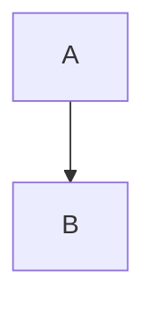

**Describe the bug**
A clear and concise description of what the bug is.

**To Reproduce**
Steps to reproduce the behavior:
1. Paste diagram source '...'
2. Click on '...'
3. See error

**Mermaid Source Snippet**

**Expected behavior**
A clear and concise description of what you expected to happen.

**Device & Browser (please complete the following information):**
 - OS: [e.g. Windows 11, macOS, iOS, Android]
 - Browser [e.g. Chrome, Firefox, Safari]
 - Version [e.g. 120]
